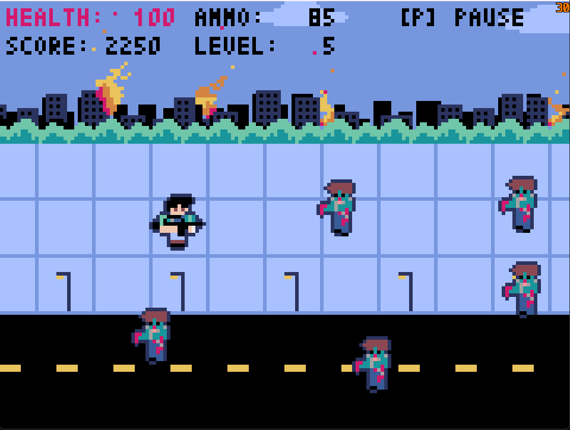

# HumansVSZombies (Zombies Invasion)

Jogo de tiro em pixel art feito com Python e [Pyxel](https://github.com/kitao/pyxel): você é o último humano em uma rua tomada por zumbis. Atire, pegue munição e kits médicos, e sobreviva o máximo que conseguir.

## Controles

| Entrada | Ação |
| --- | --- |
| `W` `A` `S` `D` ou direcional do controle | Mover |
| `Espaço` ou botão B do controle | Atirar |
| `P`, `ESC` ou Start do controle | Pausar e continuar |
| `W` / `S` e `Enter` (ou `Espaço`) | Navegar e escolher nos menus |
| `R` | Jogar de novo na tela de fim de jogo |

Acertar na cabeça rende bônus (**HEADSHOT!**).

## Geração procedural

Zumbis, munição e kits médicos são gerados de forma dinâmica, em vez de em intervalos fixos.

| Elemento | Como é gerado |
| --- | --- |
| **Nível** | Sobe a cada 500 pontos (até o 20) |
| **Zumbis** | O limite na tela cresce com o nível (de 5 até 16), o intervalo entre zumbis diminui, cada um tem sua velocidade sorteada uma vez, e a chance de um zumbi corredor aumenta. Não nascem em cima de outro |
| **Munição** | A cada 2,5 s há um sorteio. A chance vai de 10% (cheia) a 80% (zerada), e sempre aparece uma caixa quando acaba. Uma caixa por vez |
| **Kits médicos** | A cada 3,3 s há um sorteio. A chance vai de 5% a 65% conforme a vida cai, e nunca aparece com a vida cheia |

Todos os valores são constantes no topo de cada classe, em `scripts/mechanics/`.

## Cenário

O cenário tem parallax: céu, prédios, arbustos e chão (calçada e rua, juntas) rolam em velocidades diferentes, e há nuvens à deriva. A arte original juntava prédios, arbustos e fogo em uma imagem só; ao abrir o jogo, `scripts/background/layers.py` separa essas partes em camadas (em memória, sem alterar o `sprites.pyxres`), e os arbustos passam na frente dos prédios. O fogo é animado em quatro quadros (balanço, cor e ponta da chama) e solta faíscas.

## Menu de pausa e fim de jogo

- **Pausa:** congela o mundo (inclusive o cenário) e oferece *Resume*, *Restart* e *Quit*.
- **Fim de jogo:** mostra a pontuação e o recorde da sessão, com *Play again* e *Quit*.

## Como rodar

```
python -m venv .venv
.venv\Scripts\activate
pip install -r requirements.txt
python application.py
```

O arquivo `assets/sprites.pyxres` foi criado em uma versão antiga do Pyxel; o jogo o carrega normalmente e o Pyxel imprime um aviso sugerindo salvá-lo de novo no editor.

## Estrutura

| Pasta | Conteúdo |
| --- | --- |
| `application.py` | Janela, laço principal e composição das classes |
| `scripts/state/` | Estados do jogo (jogando, pausa, fim de jogo) e os menus |
| `scripts/player/` | Movimento, animação, tiro e colisão com zumbis |
| `scripts/mechanics/` | Zumbis, caixas de munição e kits médicos |
| `scripts/UI/` | Vida, munição, pontuação, nível e aviso de headshot |
| `scripts/background/` | Cenário em rolagem |
